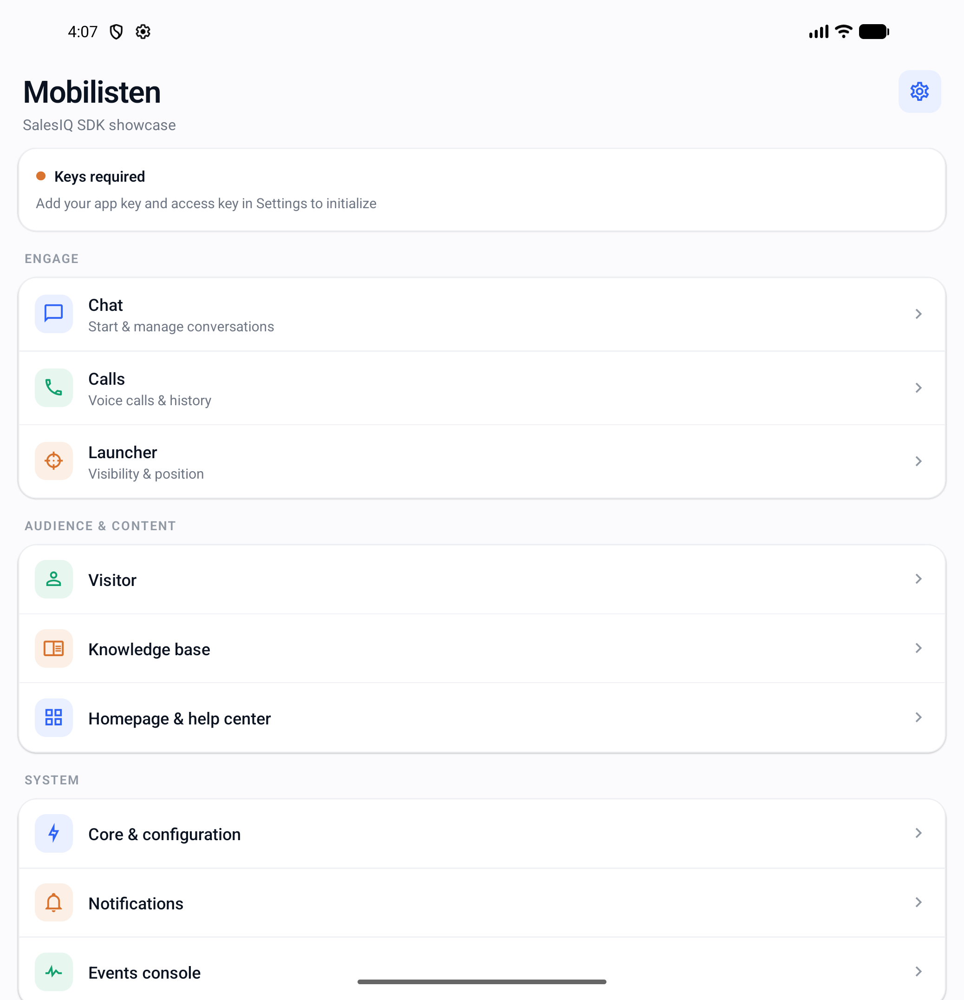
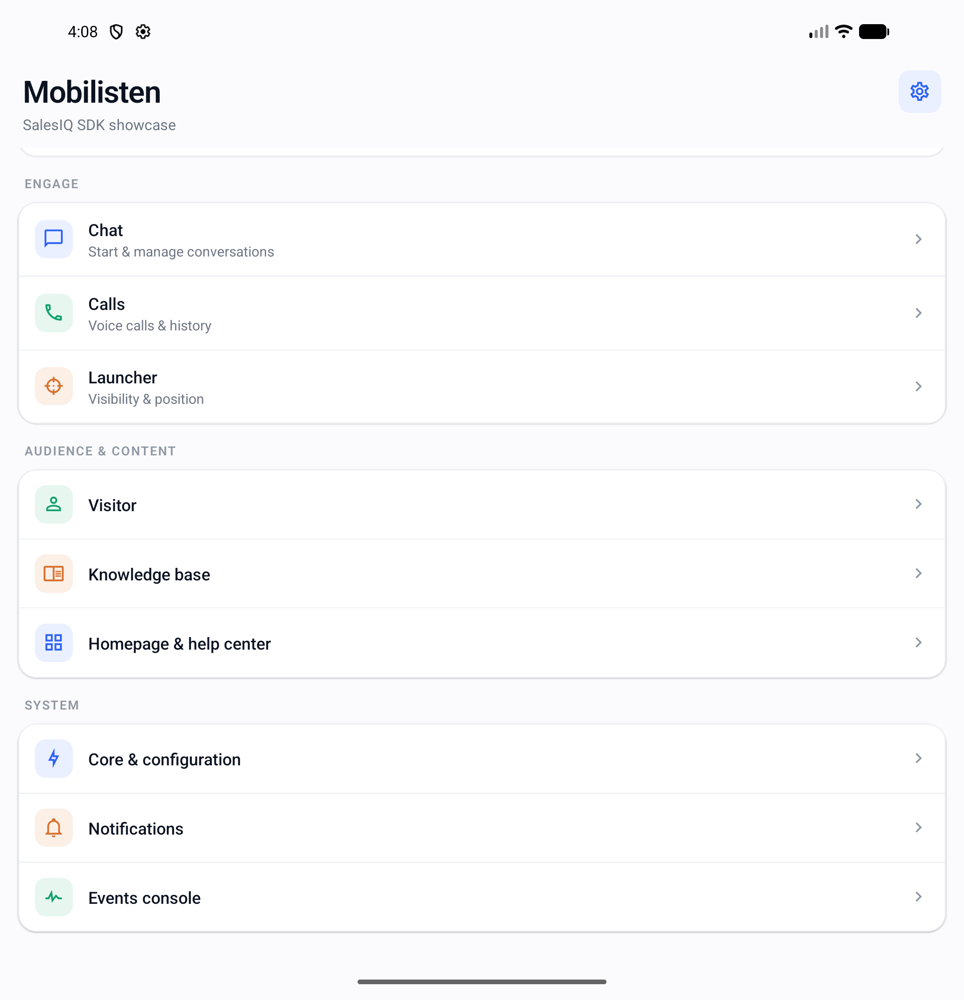
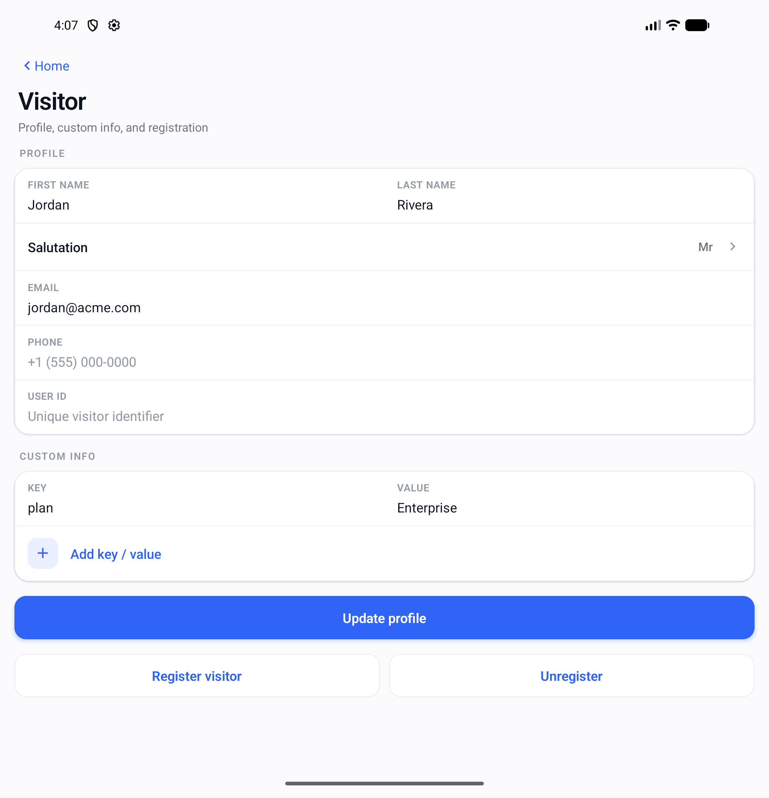

# Mobilisten sample app — React Native

A unified showcase of the Zoho SalesIQ Mobilisten SDK for React Native. The app walks through every
major capability of the SDK — live chat, calls, the visitor API, the launcher, knowledge base,
help center, notifications, and events — across eleven purpose-built screens that share one design
system.

The SDK is initialized automatically at launch and push registration is automatic; the UI only
reports status and lets you exercise each API. Nothing here uses deprecated APIs.

## Features

Eleven screens, in a fixed order, each mapping to a slice of the SDK:

1. **Home** — dashboard for every module, with a hero that reflects the automatic SDK init status
   (initialized / keys required / failed).
2. **Core & configuration** — global runtime configuration and live init status. No manual init
   button; startup is automatic.
3. **Launcher** — launcher visibility modes, drag-to-dismiss, operator image, and position.
4. **Visitor** — full visitor profile via `Visitor.updateProfile` (name, email, contact number,
   custom info), plus registration/deregistration.
5. **Chat** — start conversations and toggle chat-window components.
6. **Calls** — audio/video call entry points and live call state via the calls module.
7. **Knowledge base** — browse and search self-service articles and categories.
8. **Homepage & help center** — homepage widget visibility and the AI/agent-backed help center.
9. **Notifications** — push status (registered automatically), in-app notification toggle, action
   source, and the last received payload.
10. **Events console** — a live feed of every SDK event across chat, calls, launcher, KB, and
    notifications.
11. **Settings** — set your App key / Access key, choose light / dark / system appearance, and view
    the SDK version.

## Prerequisites

- Node.js 18 or newer.
- React Native CLI toolchain for 0.77.2 (see the
  [React Native environment setup](https://reactnative.dev/docs/environment-setup)).
- **iOS**: Xcode, CocoaPods, and Ruby (a `Gemfile` is provided for the CocoaPods toolchain).
- **Android**: JDK 17, Android SDK with `compileSdk`/`targetSdk` 35 and `minSdk` 24.
- A Zoho SalesIQ account with an App key and Access key for your bundle identifier
  (`com.mobilistensample` for Android / your iOS bundle id).

## Install and run

This example lives inside the plugin workspace, so install from the workspace root first, then run
from this directory.

```sh
# from the repo root (installs the workspace, including this example)
yarn install

# start the Metro bundler
cd example
yarn start
```

In a second terminal:

```sh
# Android
yarn android

# iOS — install pods once, then run
cd ios && pod install && cd ..
yarn ios
```

Run on a real device (verified) or a simulator/emulator. Calls features are best exercised on a
physical device.

## Adding your App key and Access key

The app ships with placeholder credentials and starts in a graceful "keys required" state until you
provide real keys.

- **Recommended:** open the **Settings** screen in the running app, paste your App key and Access
  key, and save. The SDK re-initializes immediately — no rebuild required.
- The placeholders live in `state/settings.ts` (`<YOUR_ANDROID_APP_KEY>` /
  `<YOUR_ANDROID_ACCESS_KEY>` and the iOS pair). Initialization happens automatically in `App.tsx`
  via `ZohoSalesIQ.initialize(...)` whenever the stored credentials change.

Generate keys for your bundle id from the SalesIQ portal.

## Screenshots

| Home (light) | Home (scrolled) | Visitor |
|---|---|---|
|  |  |  |

## Design system

All six Mobilisten sample apps (React Native, Android/Compose, Flutter, Cordova, iOS SwiftUI, iOS
UIKit) share a single design system — one token set for color, spacing, and type, and the same
component vocabulary and eleven-screen inventory. See
[`design/DESIGN_SYSTEM.md`](design/DESIGN_SYSTEM.md). No screen hardcodes a color, size, or font
value; everything comes from the generated `theme` tokens.

## Light and dark mode

The app follows the OS appearance by default and provides a light / dark / system override in
**Settings**. Every color token is defined as a light/dark pair pre-checked for WCAG-AA contrast.
